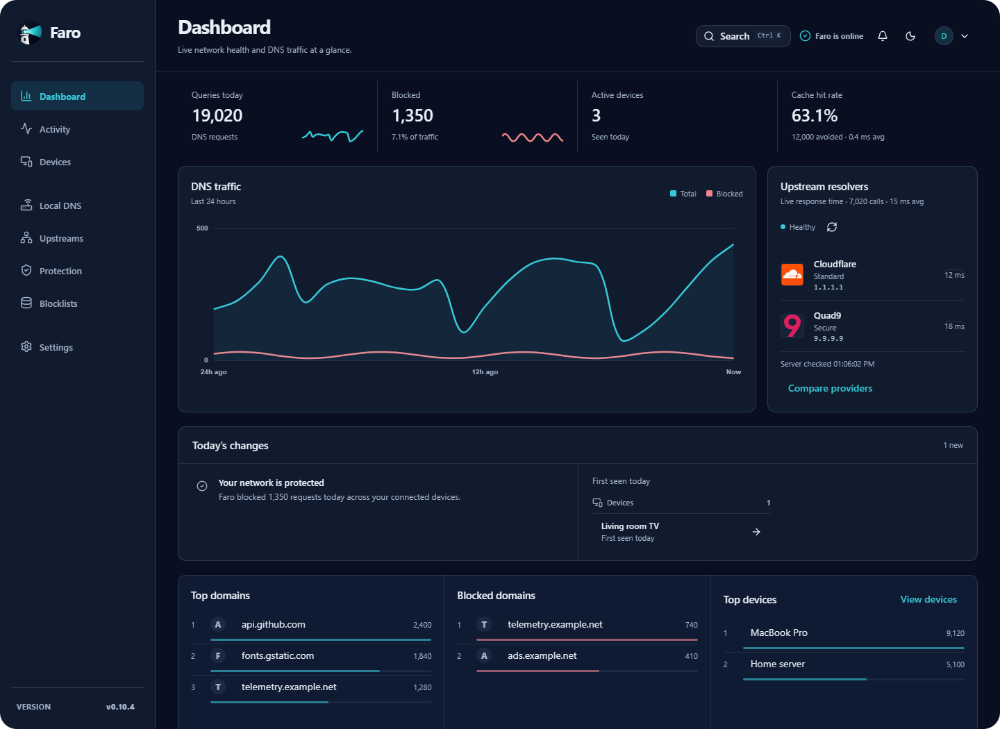
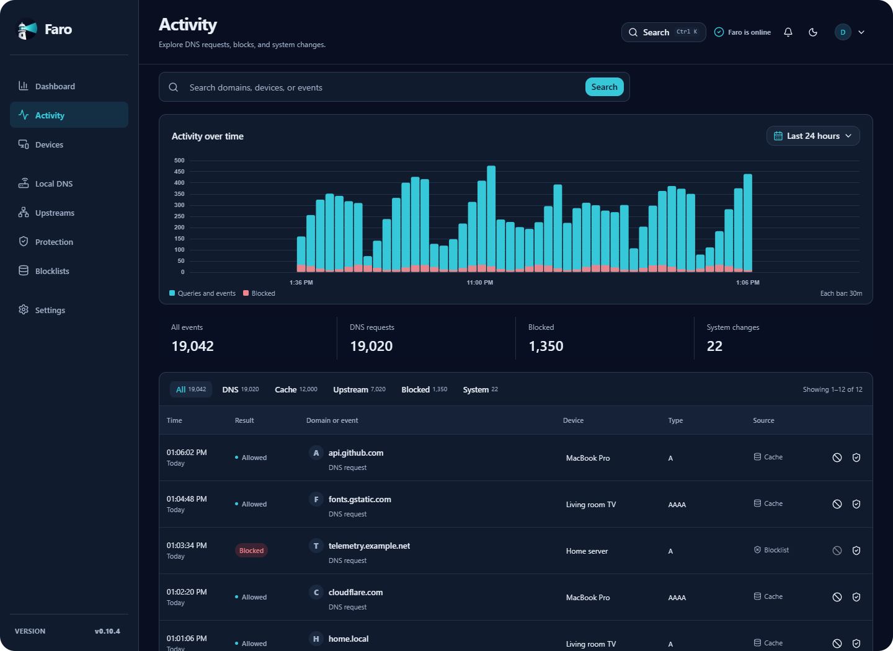
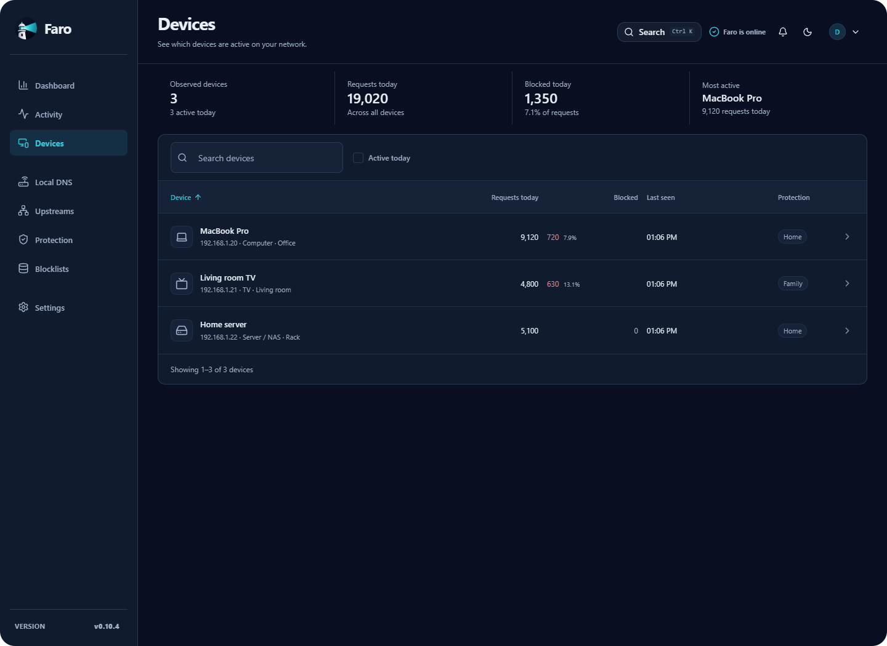

<p align="center">
  
</p>

<h1 align="center">Faro</h1>

<p align="center">
  <strong>Understand and protect your network with self-hosted DNS.</strong>
</p>

<p align="center">
  <a href="https://faro.tabierto.com">Website</a> ·
  <a href="#get-started">Get started</a> ·
  <a href="docs/README.md">Documentation</a> ·
  <a href="docs/unraid.md">Unraid</a> ·
  <a href="https://github.com/derek-diaz/Faro/discussions">Discussions</a>
</p>

Faro is a **self-hosted DNS server built on CoreDNS** for people who want to understand what the devices on their network are doing without babysitting DNS configuration.

It combines per-device DNS visibility, blocking and protection profiles, local DNS, encrypted upstreams with health checks and failover, and synchronized DNS replicas in one interface. [Get running with Docker Compose](#get-started) in a few commands.

Your DNS history and configuration stay on your hardware. Faro requires **no cloud account** and includes **no tracking**.

[](docs/screenshots/dashboard.png)

*Screenshots captured September 2026 with synthetic device names and DNS activity. Click any screenshot to view it at full size.*

## Why Faro?

Faro started with a simple problem: understanding what devices on a network are actually doing with DNS. Blocking is part of Faro, but it is not the whole product.

- **Visibility first.** See which device requested a domain, what happened, and why.
- **Protection without config-file gymnastics.** Use network-wide or per-device protection profiles, schedules, blocklists, and exceptions.
- **DNS that stays manageable.** Configure local DNS, encrypted upstreams, health checks, caching, and upstream failover from one interface.
- **Redundancy built in.** Pair read-only Faro replicas and keep accepted DNS configuration synchronized automatically.
- **Local by design.** DNS history, configuration, and backups stay on your hardware.

## Explore Faro

### See what every device is doing

Follow live and historical DNS activity. Search by device or domain, filter allowed and blocked requests, distinguish cached answers from upstream lookups, and review system events. Inspect a domain to understand why it is blocked or allowed; its current decision can differ from historical results after rules change.

[](docs/screenshots/activity.png)

### Know your devices

See each device's request volume, blocked requests, and assigned protection profile. Give devices friendly names, inspect their domains, and replay their DNS history. The optional [local UniFi integration](docs/unifi.md) improves device identification using names and addresses from your controller.

[](docs/screenshots/devices.png)

### Protection without the config-file gymnastics

Use **Home** as the default protection across your network, or assign separate profiles to selected devices. Choose blocklists, schedule blocking hours, and add exact-domain allow or block exceptions from the interface. Add [custom blocklist sources](docs/blocklists.md#add-your-own-source) when you need them.

### Two DNS servers. One Faro.

One Faro server acts as the primary for configuration. Pair additional servers as read-only replicas: they automatically receive the primary's accepted DNS configuration, and each server can answer DNS requests.

If the primary becomes unavailable, replicas continue answering with the last synchronized configuration. **Replicas do not automatically become primary**; settings changes wait for the primary to return. Client behavior with multiple DNS addresses depends on the router and device, and the primary's activity view does not merge replica query history.

See [DNS redundancy](docs/redundancy.md) for pairing, verification, and operational details.

### DNS without the airplane cockpit

CoreDNS answers the queries; Faro handles routine configuration. Manage local DNS records, caching, encrypted DNS-over-HTTPS upstreams, health checks, and upstream failover from the interface. Encryption covers Faro's connection to the upstream provider; devices still reach Faro using ordinary DNS.

## Get started

You need:

- A machine that stays on, with Docker and Docker Compose installed.
- A fixed local IP address or a DHCP reservation for that machine.
- Port **53 TCP/UDP** available for DNS and port **1787 TCP** for the web interface.
- Access to your router's DNS settings, or a device on which you can set DNS manually.

### 1. Start Faro

On Linux or macOS:

```sh
mkdir faro && cd faro
curl -LO https://raw.githubusercontent.com/derek-diaz/Faro/main/docker-compose.yml
docker compose up -d
```

<details>
<summary>Windows PowerShell</summary>

```powershell
New-Item -ItemType Directory faro -Force | Out-Null
Set-Location faro
Invoke-WebRequest https://raw.githubusercontent.com/derek-diaz/Faro/main/docker-compose.yml -OutFile docker-compose.yml
docker compose up -d
```

</details>

Using Unraid? Follow the [Unraid installation notes](docs/unraid.md).

### 2. Complete setup

Open **`http://YOUR-FARO-IP:1787`** in your browser, replacing `YOUR-FARO-IP` with the machine's local IP address. For example: `http://192.168.1.10:1787`.

Create your administrator account and follow the guided setup to choose upstream DNS providers and protection. Account creation closes automatically after the first administrator is created.

### 3. Point your devices to Faro

Set your router's **LAN/DHCP DNS server** to Faro's local IP address. The exact setting varies by router. Reconnect your devices or renew their DHCP leases so they receive the new setting.

To try Faro on one device first, set that device's DNS server manually to the same address. Open **Activity** in Faro and browse a few sites to check that requests appear.

If requests do not appear, see [installation checks](docs/installation.md#4-check-dns) and [troubleshooting](docs/troubleshooting.md).

## How DNS flows

```text
Your devices → Faro → Your chosen upstream DNS provider
               │
               └─ Protection, local DNS, cache, and activity history
```

Faro uses CoreDNS to answer DNS requests and forwards requests it cannot answer locally to your configured upstream provider. See the [architecture guide](docs/architecture.md) for process and storage details.

**Important DNS behavior:**

- Faro only sees DNS traffic sent through it. Devices using their own DNS service or implementation may bypass Faro.
- DNS blocking operates at the domain level and cannot remove every ad.
- Faro does not see webpage contents. A DNS lookup is not proof that a device visited a page.

## Update Faro

From the folder containing `docker-compose.yml`, run:

```sh
docker compose pull
docker compose up -d
```

The default configuration follows the `latest` image. Your settings and history persist in the `faro-config` Docker volume. Faro also creates a database backup before applying a schema upgrade.

For version pinning, rollback, and failed upgrades, see [updates and recovery](docs/updates.md). You can also download a [passphrase-encrypted backup](docs/backup-restore.md) from Faro's interface before updating.

## Documentation

| I want to… | Guide |
| --- | --- |
| Change ports, settings, or deployment options | [Configuration](docs/configuration.md) |
| Install on Unraid | [Unraid setup](docs/unraid.md) |
| Investigate a site that stopped working | [Fix a broken site](docs/fix-a-site.md) |
| Connect UniFi for device identification | [UniFi integration](docs/unifi.md) |
| Run more than one Faro server | [DNS redundancy](docs/redundancy.md) |
| Manage storage, backups, and recovery | [Persistent data](docs/backup-restore.md) |
| Run from source or understand the backend | [Local development](docs/development.md) and [architecture](docs/architecture.md) |

## Built on

Faro uses [CoreDNS](https://coredns.io/) as its DNS engine and packages the application for straightforward self-hosted deployment with Docker.

Faro is built and tested on a real home network. [Issues](https://github.com/derek-diaz/Faro/issues), [ideas](https://github.com/derek-diaz/Faro/discussions), and [contributions](docs/development.md) are welcome.

## License

Copyright 2026 Derek Diaz Correa. Licensed under the [Apache License, Version 2.0](LICENSE).

<p align="center">Made in Puerto Rico.</p>
